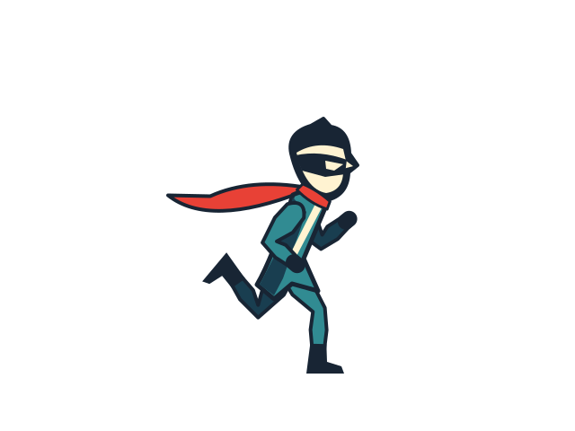

# Redline construction evidence

These three complete static drawings illustrate the figure, boot and cape-neckpiece lessons in [human action construction](../../skills/draw-authoring/references/human-action-construction.md). They are representative exports from a 17-drawing attachment review, not an animation, a complete game asset set or general anatomy standards. Original character proportions are intentionally stylized.

| Drawing | Editable project | Vector export | Image |
| --- | --- | --- | --- |
| Run weight reception | [JSON](redline-construction-evidence/run-reception.json) | [SVG](redline-construction-evidence/run-reception.svg) | [PNG](redline-construction-evidence/run-reception.png) |
| Walk opposite contact | [JSON](redline-construction-evidence/walk-opposite-contact.json) | [SVG](redline-construction-evidence/walk-opposite-contact.svg) | [PNG](redline-construction-evidence/walk-opposite-contact.png) |
| Neutral model | [JSON](redline-construction-evidence/neutral.json) | [SVG](redline-construction-evidence/neutral.svg) | [PNG](redline-construction-evidence/neutral.png) |

The [before audit](redline-construction-evidence/attachment-audit-before.json) records a recovery cuff pointing away from the calf and foot-frame discrepancies of about 175° in run-0 and 85° in walk-4. The [after audit](redline-construction-evidence/attachment-audit-after.json) checks both boots in all 17 drawings under the deliberately chosen planar model. A geometric pass does not establish visual quality.

Actual native Inkscape exports, enlarged labelled strips and three individual PNGs received fresh image review, scoped to boot and neckpiece attachment. Both anatomical boots and all 17 neckpieces were inspected. The owner accepted the improvement. The case still has crowded folded-leg silhouettes, and neither that attachment review nor these static drawings accepts full animation or gameplay.

The [artifact manifest](redline-construction-evidence/manifest.json) binds the 11 bundled source/export/audit files by SHA256. The JSON projects are independently rebuildable with the existing Agent Draw static build command. The original 17-frame exporter receipt and wider work-in-progress game are not represented as a complete bundled reproduction here.

The [paired guidance probe](craft-guidance-review.md) records a separate limitation: both guided and baseline agents solved its small numeric task. The guide produced a more explicit review plan in that one comparison; a geometry improvement caused by the prose was not demonstrated.
